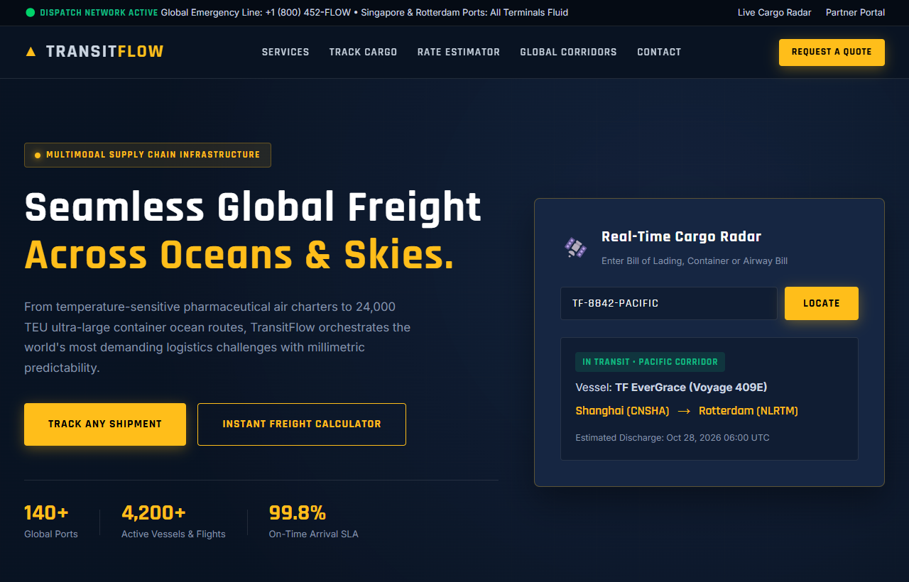

# TransitFlow (Toxa) — Xalqaro Yuk Tashish & Logistika Ekotizimi

TransitFlow — global dengiz konteynerlari, tezkor avia charterlar, bojxona omborlari va multimodal ta'minot zanjiri infratuzilmasining korporativ darajadagi veb-interfeysi (UI).

---

## 📸 Veb-Sahifa Ko'rinishi (Skrinshot)

---

## 🌟 Asosiy Imkoniyatlar va Funksiyalar

1. **Global Dengiz & Logistika Korporativ Dizayni**:
   - To'q flot ko'ki (`#091322`), yuk xavfsizligi sariq-amber rangi (`#ffbe1a`) va aniq texnik chiziqlar.
   - `Rajdhani` va `Inter` sanoat shriftlari.

2. **Jonli Yuk Radari (Live Cargo Radar)**:
   - Bill of Lading yoki konteyner raqami (masalan, `TF-8842-PACIFIC`) kiritilganda hozirgi kema joylashuvi, suzish tezligi va taxminiy tushirish (ETA) vaqtini ko'rsatuvchi vidjet.

3. **Multimodal Yuk Tariflarini Hisoblash Kalkulyatori**:
   - Jo'natish porti, yetkazish manzili, transport turi (Dengiz FCL, Tezkor Avia, Temiryo'l) va yuk vazni (KG) bo'yicha lahzada spot narx va yetkazish muddatini hisoblash.

4. **Bosqichma-bosqich Marshrut Xaritasi (Milestone Journey)**:
   - Ombordan qabul qilish, eksport bojxonasi, dengiz tranziti, import tushirish va yakuniy mijozga topshirish bosqichlari.

5. **24/7 Global Dispetcherlik Markazi**:
   - Rotterdam va Singapur operatsion markazlari bilan zudlik bilan bog'lanish va korporativ tender yuborish shakli.

---

## 🛠 Texnologiyalar Steki

- **HTML5**: Korporativ logistika portali arxitekturasi.
- **CSS3 (Vanilla)**: Radar vidjeti, yuk konteynerlari gridi, adaptiv jadvallar.
- **JavaScript (ES6+)**: Radar kod qidiruvi, transport rejimlari bo'yicha narx hisoblash mexanizmi.
- **Shriftlar**: Google Fonts (Rajdhani, Inter).

---

## 🔗 Havolalar

- **GitHub Repositoriyasi**: [https://github.com/qodirovtoirbektts-jpg/toxa-transitflow](https://github.com/qodirovtoirbektts-jpg/toxa-transitflow)
- **Jonli Veb-Sahifa (Live Demo)**: [https://qodirovtoirbektts-jpg.github.io/toxa-transitflow/](https://qodirovtoirbektts-jpg.github.io/toxa-transitflow/)

---

### 👨‍💻 Muallif
**Toxa (qodirovtoirbektts-jpg)**
